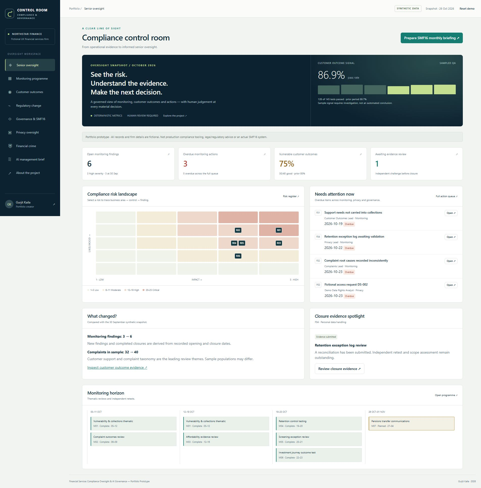
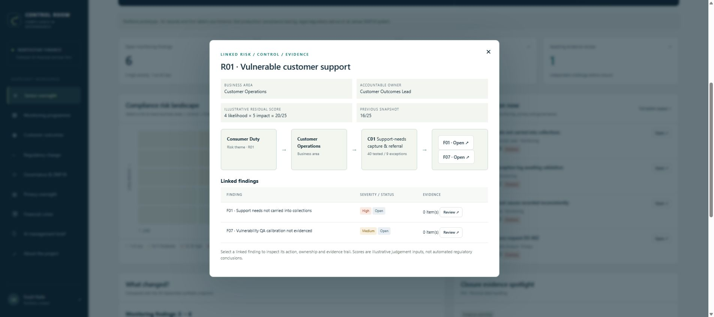
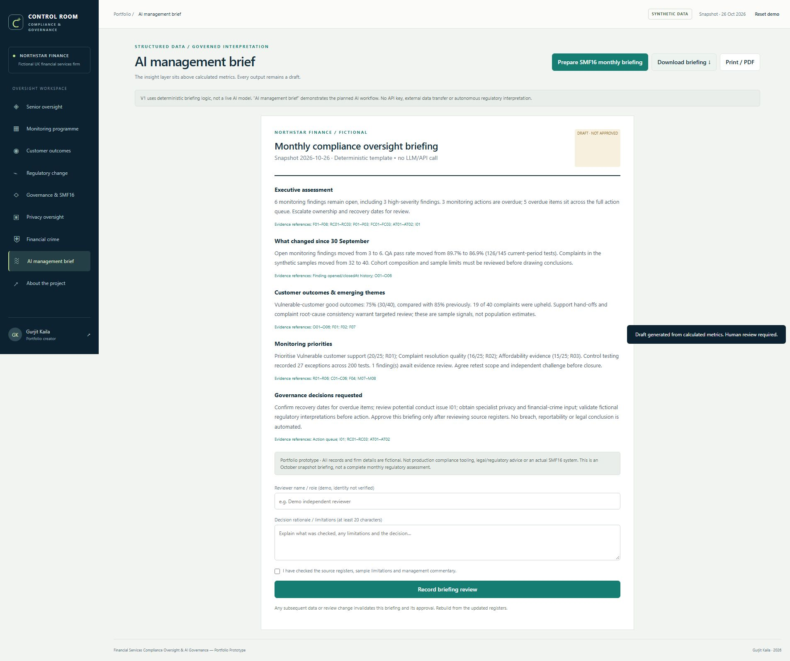
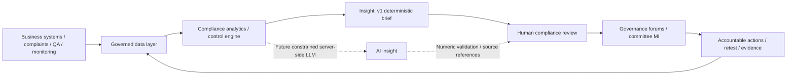

# Financial Services Compliance Oversight & AI Governance — Portfolio Prototype

**Gurjit Kaila | AI Compliance Oversight & SMF16 Governance Command Centre**

A working compliance control room demonstrating business analysis, compliance transformation and governed AI workflow design for UK regulated financial services.

**[Open the live control room](https://gurjit-compliance-control-room.onrender.com)** · **[Recruiter introduction](https://gurjit-compliance-control-room.onrender.com/#about)**



> **Portfolio prototype. All firm details, people/roles, records, outcomes, evidence and regulatory scenarios are fictional. Not production compliance tooling, legal/regulatory advice or an actual SMF16 system.**

## Career positioning

Gurjit's practical experience across remediation, Consumer Duty, complaints, outcome testing, pensions, investments and regulated customer journeys informed the operational requirements and workflow design. This project demonstrates translating those needs into controls, monitoring, MI, escalation paths and human approval points.

**Gurjit does not claim SMF16 status, Head of Compliance accountability, formal second-line leadership responsibility, direct GDPR operational experience or expert financial-crime practice.** The senior oversight view is inspired by the information and controls a compliance function may need, not a representation that he has performed the accountable role.

The user-supplied UpCredit Senior Compliance Lead advert was the design blueprint for monitoring, advisory-style assessment, customer outcomes, privacy, governance and regulatory change. The project is independent, with no UpCredit affiliation or endorsement. The supplied advert, rather than a claim of ongoing vacancy availability, is the design input.

## Recruiter walkthrough — three minutes

1. Open **Senior oversight**. See what changed, what is overdue and which risks need attention.
2. Select **R01** on the risk map. Trace the theme through Customer Operations, control C01 and findings F01/F07.
3. Open **Monitoring programme**, inspect F04 and its evidence limitations. Use a demo independent reviewer and meaningful rationale to simulate review. Closure is blocked without submitted evidence and human validation; the action owner cannot approve their own closure.
4. Watch the calculated counts refresh. Prepare an **SMF16 monthly briefing**. Inspect source references and record a human review before exporting.
5. Explore fictional regulatory impact assessment, specialist privacy/financial-crime review and governance attestations. Export the session decision trail.

### Short recruiter explanation

“I used my regulated financial-services experience to build a working prototype of compliance oversight. It shows how I translate operational problems into linked controls, monitoring, MI and human-reviewed management briefings. It demonstrates BA and compliance-transformation capability; it is not a claim that I have held an SMF16 role.”

### CV-ready bullets

- Designed and built a compliance oversight portfolio prototype, translating experience in remediation, Consumer Duty, complaints and regulated customer journeys into monitoring, outcome MI, accountable actions and governance workflows.
- Modelled linked risks, controls, findings and closure evidence, with deterministic calculations, overdue escalation and independent human review gates.
- Designed a governed AI insight workflow that separates source metrics from interpretation, generates traceable draft management briefings and requires human approval before governance use; implemented deterministic summarisation for v1.

## Implemented modules

| Module | Demonstrated workflow |
| --- | --- |
| Compliance Monitoring Programme | Dated plan and thematic reviews, control samples, findings, severity, owners, deadlines, validation, evidence submission and independent closure |
| Consumer Duty & Customer Outcomes | Complaints, upheld counts, QA, vulnerability samples, journey splits, root causes, prior-period comparisons and cautious management commentary |
| Regulatory Change | Explicitly invented scenarios, product/process impact, actions, owners and human interpretation review before implementation planning |
| Governance & SMF16 Oversight | Risk register, issues awaiting assessment, full action queue, attestations, committee/board-style briefing and session decision trail |
| Privacy Oversight | Fictional DPIA-style register, DSAR target and data incident triage; specialist review, no legal/reportability determination |
| Financial Crime Oversight | Fictional AML/fraud/sanctions oversight exposure and accountable actions, linked to R05/C05/F05 |
| AI Management Brief | Polished deterministic monthly draft based exclusively on shared calculated metrics; source references, review, Markdown export and print/PDF |
| Human review | Finding validation, interpretation review, independent closure, attestations, specialist review and briefing approval; changes invalidate earlier briefing |

The risk matrix is interactive. Selecting a risk opens a relationship view connecting **theme → business area → control → findings → evidence**. The monitoring calendar supports October/November and review drill-down. Search and filters support the finding register and the full action queue.





## Data & deterministic calculations

The entire fictional dataset is in [`dist/data.json`](data.json). The demo clock is fixed at **26 October 2026**, avoiding drifting overdue counts. September is the comparison period; October is a snapshot, not a complete month. Seed records are never submitted to external services.

`dist/engine.js` supplies the dashboard, queues and briefing with the same functions:

- Open findings: opened on/before snapshot and not closed on/before it.
- Overdue monitoring: open findings with `due < asOf`; due today is not overdue.
- Full-queue overdue: unresolved monitoring, change, privacy, financial crime, attestation and issue items. Attested/closed items are excluded. Privacy/financial-crime dates are **internal demo targets**, not legal deadlines.
- QA pass: total passed / total tested across the selected month's journey samples; weighted by counts, not an average of percentages.
- Vulnerable good outcomes: total good / total vulnerable tested. Criteria and samples are illustrative.
- Risk score: supplied illustrative residual likelihood × impact, 1–25; not calculated legal compliance.
- Control exceptions: sum of failed sampled tests, separate from breach/issue assessment.

Initial fixture: **6 open findings, 3 high, 3 overdue monitoring actions, 5 full-queue overdue items; 126/145 QA passes (86.9%); 30/40 vulnerable good outcomes (75%); 40 complaints, 19 upheld; 27 exceptions across 200 control tests.** Previous sample: 130/145 QA passes (89.7%), 34/40 vulnerable good outcomes (85%), 32 complaints, 3 open findings.

No population-level, causal or regulatory conclusion should be drawn from the sample metrics. There is no live regulatory feed. RC01–RC03 are entirely invented; no FCA/ICO publication is represented.

## Architecture



**Current implementation:** dependency-free HTML/CSS/JavaScript, static JSON, pure metric functions and in-memory session state. Render static hosting serves the public site. Node's built-in HTTP server supports local preview. No API keys, customer data, analytics trackers, external fonts, user accounts, database or live model. Reload/reset clears demo decisions. Export preserves a reviewable copy only; it is not a tamper-evident audit record.

**Future production architecture (not implemented):** authenticated role-based reviewer permissions, durable evidence storage, immutable audit events, data quality reconciliations, record-level lineage, access/retention controls, independent review, specialist-approved regulatory taxonomy and validated integration interfaces. A proper reasonable-steps evidence framework would require accountable roles, scope, decisions, challenge, follow-through and qualified review; this prototype is not sufficient to establish it.

**Future LLM boundary (not implemented):** server-side `/api/brief` only; no browser secrets. Supply a validated metrics JSON and approved commentary context. Apply authenticated per-user/IP rate limits, input size caps, output schema, numeric/source reconciliation, prompt-injection isolation, logging/retention controls and spend limits. Fall back to deterministic text on mismatch or outage. Every output remains a draft for human review. No legal interpretation or individual customer decision should be automated.

See [`docs/requirements.md`](docs/requirements.md) for requirements traceability, acceptance checks and design tradeoffs.

## Run & verify

Requires Node 22 (the deployment runtime is pinned to the Node 22 major version). No dependency installation is needed.

```sh
npm test
npm run build
npm start
```

Open `http://localhost:4173`. The Render service uses the supplied `PORT`. `npm run build` validates the dataset and copies this README into the static site. `dist/` can alternatively be hosted on a static host; retain module and JSON files with correct content types.

Tests independently reconcile fixture totals and prior-period results, exercise blocked and permitted closure transitions, ensure queue/briefing consistency after closure and check draft/source-reference controls. Browser QA should cover all views, filters, evidence review, monthly brief, keyboard dialog dismissal and narrow-screen layout.

## Deployment

GitHub repository: https://github.com/gurj86/ai-compliance-control-room

Live site: https://gurjit-compliance-control-room.onrender.com

`render.yaml` defines a separate static site. In Render, choose **New Static Site → Public Git Repository**, use this repo, build `node build.mjs`, publish directory `dist`, and deploy. Alternatively import the Blueprint. No environment secrets are required. The deployed static site avoids web-service cold starts.

## Known limitations

- Session-only approvals and self-entered names are workflow demonstrations, not enforced identity/role controls. There is no durable persistence, authentication or tamper-resistant audit.
- No real LLM calls, live regulatory content, legal deadline engine, production integrations, actual documents or sensitive customer data.
- Evidence consists of fictional text summaries; there is no file validation, malware scanning or immutable evidence repository.
- The deterministic briefing prioritises illustrative risk scores and linked findings; no expert risk judgement is claimed.
- Attestations and review decisions do not establish compliance or discharge obligations. Specialist actions remain open until properly resolved; a review alone does not close them.
- The app must not be used to assess real customers or support actual regulatory decision-making.

© 2026 Gurjit Kaila. Portfolio demonstration.
